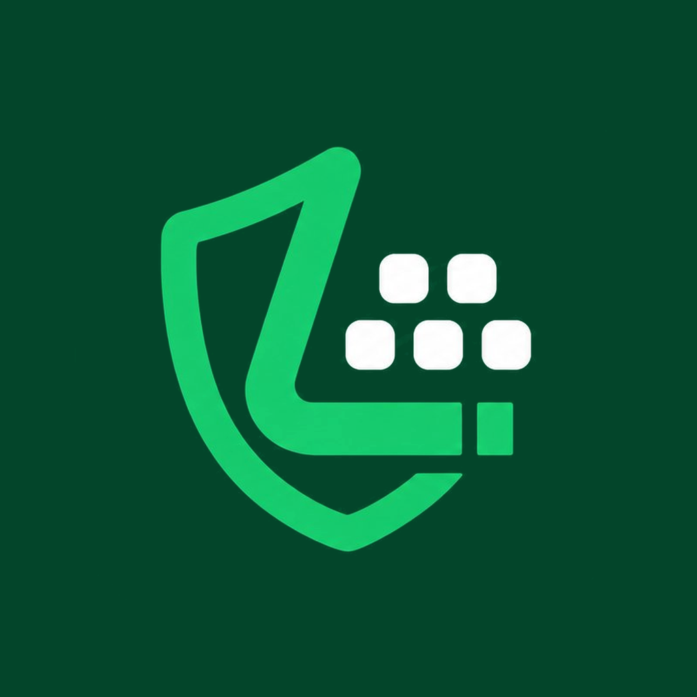

  

<h1 align="center">Lipik - Privacy Keyboard</h1>

<b>Write with privacy.</b>

Lipik is a privacy-first Android keyboard. What you type stays on your phone — no ads, no tracking, open source.

## Why Lipik ?

- 🔒 **Privacy by design** — what you type never leaves your device
- 🚫 **No ads, no tracking** — no analytics, no data collection
- ⌨️ **Phonetic typing** — write Bangla with English letters
- 🌍 **Six languages** — Bangla, English, Hindi, Nepali, Urdu and Arabic
- 📖 **Big dictionary** — new words reach you without an app update
- 📴 **Offline-first** — no internet needed for typing (only for dictionary and language pack downloads)
- 🎨 **Themes and emoji** — make the keyboard yours

## Install

1. Download **Lipik-Keyboard.apk** from the [latest Release](https://github.com/hmjoy17/Lipik/releases/latest)
2. Install the APK (allow "install unknown apps" if Android asks)
3. Open your phone's **Settings → System → Languages & input → On-screen keyboard** and enable **Lipik**
4. Open any app, bring up the keyboard, and switch to Lipik

## Language packs

Need a dictionary for another language? Download a language pack from inside the app's **Settings**. New dictionary words also arrive inside the app — Settings → Correction → **Check for dictionary updates**.

## Your data, your control

- Words the keyboard learns from you (your personal dictionary) stay only on your phone — they are never uploaded anywhere
- © 2026 Lipik

---

**Lipik** — Made with care. Designed for privacy.
